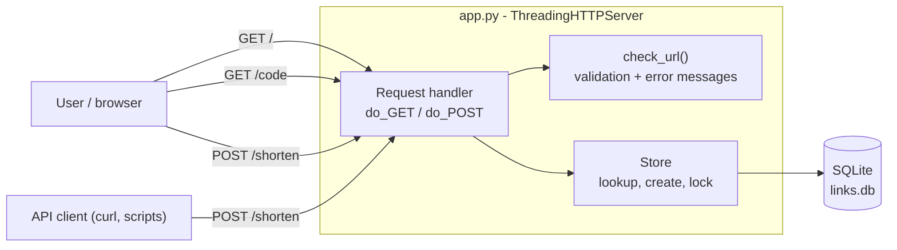
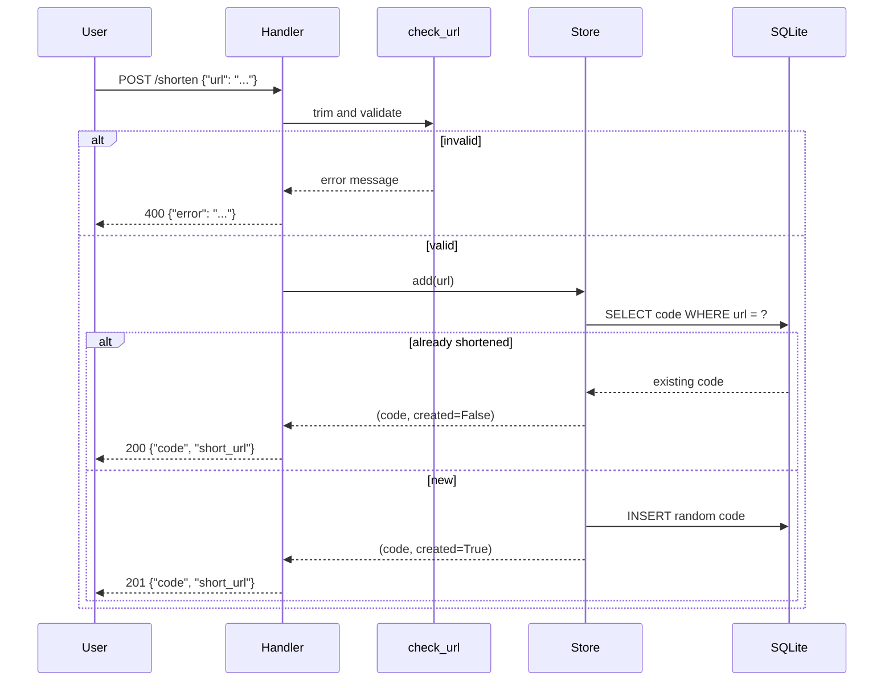
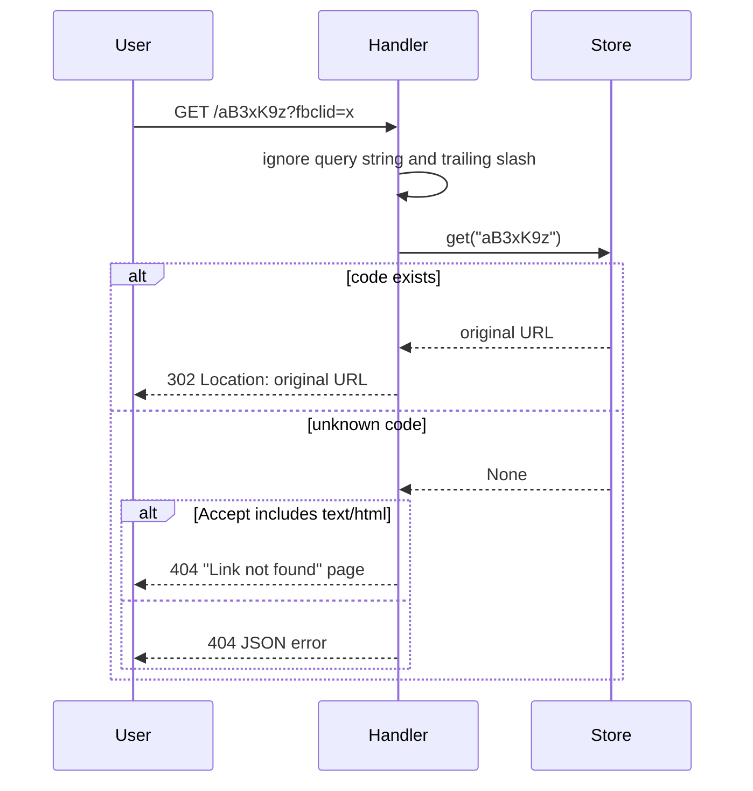

# URL Shortener

A minimal URL shortener HTTP service. Paste a long URL, get a short link, share it. Opening the short link takes you to the original page.

## Features

| Capability | Behaviour |
|---|---|
| **Shorten a URL** | A web form at `/` and a JSON API at `POST /shorten`. The result is a 7-character link, with a Copy button on the form. |
| **Redirect** | Opening a short link returns a `302` redirect to the original URL. |
| **No duplicates** | Shortening the same URL again returns the existing short link (`200`) instead of creating a new one (`201`). |
| **Clear errors for invalid URLs** | Each problem gets its own message, for example "The URL is missing its start. Did you mean https://example.com?" |
| **Clear "not found"** | Browsers get a readable page. API clients get a JSON error. Both use status `404`. |
| **Persistence** | Links are stored in SQLite and survive restarts. |

## Tech stack

Python standard library only. There is nothing to install.

| Layer | Technology |
|---|---|
| Language | Python 3 (developed and tested on 3.13) |
| HTTP server | `http.server.ThreadingHTTPServer`, one thread per request |
| Storage | `sqlite3`, a single `links` table in `links.db` |
| Short codes | `secrets` (random base62: `a-z`, `A-Z`, `0-9`) |
| Front end | One inline HTML page with vanilla JavaScript (`fetch`, Clipboard API) |
| Tests | `unittest`, running against a real server on a free port |

## Architecture



### Shortening a URL



### Opening a short link



## Getting started

```
cd url_shortener
py -3 app.py          # Windows; use python3 app.py on macOS/Linux
```

The server listens on `http://127.0.0.1:8000`. Open that address in a browser to use the form. It creates `links.db` in the folder you start it from.

### Run the tests

```
cd url_shortener
py -3 -m unittest -v
```

## API

### `POST /shorten`

Request body:

```json
{ "url": "https://example.com/some/very/long/path" }
```

| Status | Meaning | Body |
|---|---|---|
| `201` | New short link created | `{"code": "aB3xK9z", "short_url": "http://localhost:8000/aB3xK9z"}` |
| `200` | URL was already shortened; same link returned | same shape as `201` |
| `400` | Invalid URL or request body | `{"error": "<what is wrong>"}` |

```
curl -X POST localhost:8000/shorten -d '{"url":"https://example.com/long/path"}'
```

### `GET /<code>`

| Status | Meaning |
|---|---|
| `302` | Redirects to the original URL (`Location` header) |
| `404` | Unknown code. Browsers (`Accept: text/html`) get an HTML page. Other clients get `{"error": "Short link not found. ..."}` |

Query strings (such as `?fbclid=...` added by chat apps) and a trailing slash are ignored when looking up the code. They are not passed on to the destination.

### `GET /`

Returns the web form.

## Behaviour details

### URL validation

A URL is rejected, with a message explaining why, when it:

| Problem | Example input |
|---|---|
| is empty or missing | `""`, no `url` field |
| is not text | `123` |
| has no `http(s)://` start | `example.com` (the message suggests `https://example.com`) |
| uses another scheme | `ftp://x.com`, `javascript:alert(1)` |
| has no host | `http://`, `https:///path` |
| contains spaces | `http://my site.com` |
| has an invalid port | `http://example.com:abc`, `:99999` |
| is longer than 2048 characters | |

Spaces around the URL are trimmed first. Validation checks the URL is well-formed. It does not check that the site exists.

### Duplicates

Matching uses the exact text of the URL. `https://example.com` and `https://example.com/` count as different URLs and get different codes. The lookup and insert run under one lock, so simultaneous requests for the same URL get one code.

The `links` table has no UNIQUE constraint on `url`, so an older database that already contains duplicates still loads. A repeat request returns the oldest code.

### Redirects and special characters

The `Location` header is percent-encoded, so URLs containing non-ASCII characters (for example `café` or Japanese text) redirect correctly. Existing escapes such as `%20`, and the query string and `#fragment`, are preserved.

## Project layout

```
url_shortener/
  app.py        # server, validation, storage, web form
  test_app.py   # tests
  README.md
  links.db      # created on first run
```

## Limits and known gaps

This is intentionally minimal and is not production-ready as it stands.

- Listens on `127.0.0.1` only. Change the host in `make_server()` to expose it.
- Short links are built from the request's `Host` header. Behind a proxy or on a public domain, set a fixed base URL.
- No authentication, rate limiting, link expiry, custom aliases or click counts.
- Only GET and POST are handled. `HEAD` requests (sent by some link-preview bots) return `501`.
- Storage is one SQLite file guarded by a process-wide lock, so it suits a single server process, not several.
- The page is plain HTML and JavaScript, with no build step.
